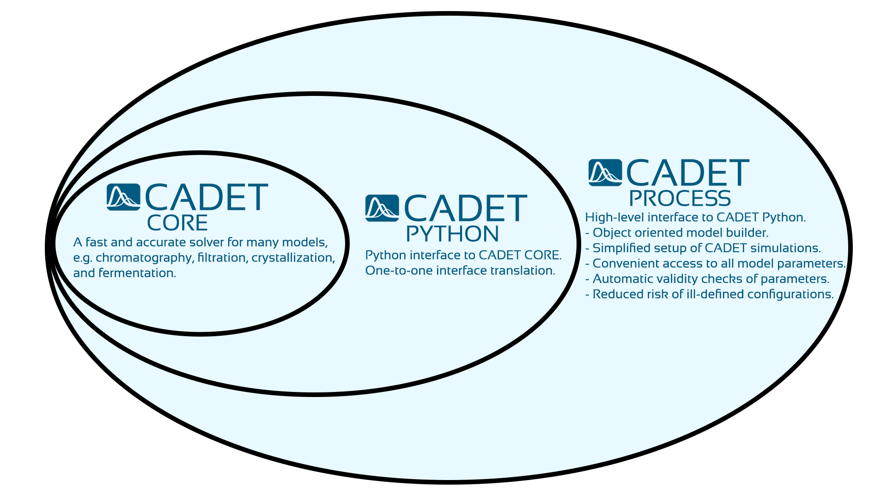

.. _contents:

|

.. image:: https://img.shields.io/github/release/cadet/cadet-core.svg
   :target: https://github.com/cadet/cadet-core/releases

.. image:: https://github.com/cadet/cadet-core/actions/workflows/ci.yml/badge.svg?branch=master
   :target: https://github.com/cadet/cadet-core/actions/workflows/ci.yml?query=branch%3Amaster

.. image:: https://joss.theoj.org/papers/282a9ec56a0680e51ed4f1fa8fda3650/status.svg
   :target: https://joss.theoj.org/papers/282a9ec56a0680e51ed4f1fa8fda3650

.. image:: https://anaconda.org/conda-forge/cadet/badges/downloads.svg
   :target: https://anaconda.org/conda-forge/cadet

.. image:: https://zenodo.org/badge/DOI/10.5281/zenodo.8179015.svg
   :target: https://doi.org/10.5281/zenodo.8179015

.. image:: https://img.shields.io/badge/JuRSE_Code_Pick-Oct_2024-blue.svg
   :target: https://www.fz-juelich.de/en/rse/community-initiatives/jurse-code-of-the-month/october-2024

|

CADET-Core
==========

CADET is developed at the Institute of Bio- and Geosciences 1 (IBG-1) of Forschungszentrum Jülich (FZJ) under supervision of Prof. Eric von Lieres.
The heart of the CADET software is CADET-Core, a fast and accurate solver for a comprehensive model family.
Typical applications include (but are by far not limited to) chromatography, filtration, crystallization, and fermentation.
CADET-Core can handle arbitrary sequences and networks of unit operations, including reactors, tanks, tubes, pumps, valves, detectors, etc.
The resulting models are solved with state-of-the-art mathematical algorithms and scientific computing techniques.

- **Forum:** https://forum.cadet-web.de
- **Source:** https://github.com/cadet/cadet-core

To stay up to date on CADET news, development updates, and workshops, please subscribe to our `Newsletter <http://eepurl.com/hzN4EP>`_.

Features
--------

* Fast and accurate solution of strongly coupled partial differential algebraic equations (PDAE)
* Computation of parameter sensitivities with algorithmic differentiation (AD)
* Shared memory parallelization using Intel TBB
* Python interface
* Support of HDF5 and XML data formats
* Flexible and extensible through modular design
* Works on Windows, Linux, and Mac OS X

CADET Platform
--------------

CADET-Core is part of `CADET <https://github.com/cadet>`_, a collective platform of software repositories that provide tools for biotechnology process modeling.
CADET-Core can be used as a standalone simulator by interfacing via HDF5 files. Alternatively, CADET-Python provides a wrapper around an HDF5 file reader and writer, simplifying model configuration.
Furthermore, it is the interface for CADET-Process, an universal and user-friendly tool for biotechnology process modeling and evaluation.

For more information on the different packages of the CADET platform, see :ref:`here <getting_started>`.

   Relations between CADET-Core, CADET-Python, and CADET-Process.

Installation
------------

CADET-Core can be installed via conda from the ``conda-forge`` channel.

``conda install -c conda-forge cadet``

This requires a working `conda installation <https://docs.anaconda.com/anaconda/install/index.html>`_.

Optionally, use `mamba <https://github.com/mamba-org/mamba>`_ which uses a faster dependency solver than ``conda``.

``mamba install -c conda-forge cadet``

For more information on how to install and build CADET, see :ref:`here <getting_started>`.

Ongoing Development
-------------------

We do our best to provide you with a stable API.
However, CADET-Core is actively developed and breaking changes can sometimes be unavoidable.
For non-developers, it is recommended to upgrade from release to release instead of always working with the most recent commit.

Bugs
----

Please report any bugs that you find `here <https://github.com/cadet/cadet-core/issues>`_. Or, even better, fork the repository on `GitHub <https://github.com/cadet/cadet-core>`_ and create a pull request (PR) with the fix.

Donations
---------

`Donations <https://www.paypal.com/cgi-bin/webscr?cmd=_s-xclick&hosted_button_id=FCQ2M89558ZAG>`_ for helping to host, maintain, and further develop the CADET-Core project are highly appreciated.

Citing
------

As an open-source project, CADET-Core relies on the support and recognition from users and researchers to thrive.
Therefore, we kindly ask that any publications or projects leveraging the capabilities of CADET-Core acknowledge its creators and their contributions by citing an adequate selection of our publications.

**General:**

- Breuer, J. M.; Leweke, S.; Schmölder, J.; Berger, A.; Gassner, G. J.; von Lieres, E.: `A unified and composable framework for modeling packed-bed liquid chromatography <https://doi.org/10.48550/arXiv.2610.33269>`_, arXiv preprint arXiv:2610.33269 (2026).

- Leweke, S.; Breuer, J.; Schmölder, J.; Jäpel, R.; Lanzrath, H.; Rao, J.; Hassan, J.; Zhang, W.; Berger, A.; Heymann, W.; von Lieres, E.: `CADET-Core 5.0: High-Performance Solver for Advanced Biotechnology Process Modeling <https://doi.org/10.21105/joss.07881>`_, Journal of Open Source Software **10** (2025), 7881.

- Leweke, S.; von Lieres, E.: `Chromatography Analysis and Design Toolkit (CADET) <https://doi.org/10.1016/j.compchemeng.2018.02.025>`_, Computers and Chemical Engineering **113** (2018), 274–294.

Additionally, to ensure reproducibility of your work, we recommend citing the `zenodo doi <https://doi.org/10.5281/zenodo.8179015>`_ corresponding to the specific CADET-Core release that you used.

Beyond these general references, major extensions have enabled specific features of CADET-Core, such as the DG discretization, the crystallization models, or the parameter sensitivities.
If your work makes use of such a feature, please cite the corresponding publication as well.
For a comprehensive list of our publications and guidance on citing them, please refer to the :ref:`publications` section of this documentation.

Acknowledgments
---------------

Please refer to the `list of authors and contributors <https://github.com/cadet/cadet-core/blob/master/AUTHORS.md>`_ who helped building and funding this project.

.. toctree::
    :maxdepth: 3
    :hidden:

    getting_started/index
    modelling/index
    simulation/index
    interface/index
    developer_guide/index
    CADET-Match <https://cadet.github.io/CADET-Match/master/index.html>
    license
    publications
    zbibliography
    Legal notice <https://www.fz-juelich.de/en/legal-notice>
