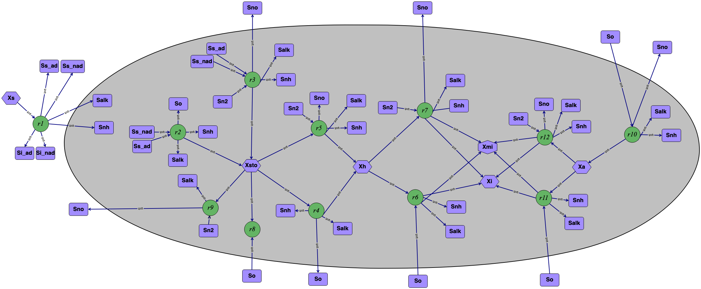

(activated-sludge-model)=

# Activated Sludge Model (ASM3h)

The Activated Sludge Model 3 extended (ASM3h) is a comprehensive reaction model for simulating biological
wastewater treatment processes. It belongs to the Activated Sludge Models (ASM) family, a set of standardized
models developed by the International Water Association (IWA). The ASM3h model describes the fate of 13
biochemical components in wastewater treatment systems.

## Model Components

The ASM3h model tracks 13 biochemical components representing species and compounds in wastewater:

| Abbreviation | Component |
| --- | --- |
| $S_O$ | Dissolved oxygen |
| $S_S$ | Readily biodegradable substrate |
| $S_{NH}$ | Ammonium |
| $S_{NO}$ | Nitrite and nitrate |
| $S_{N2}$ | Dinitrogen, released by denitrification |
| $S_{ALK}$ | Alkalinity, bicarbonate |
| $S_I$ | Soluble inert organic |
| $X_I$ | Inert Particulate organic |
| $X_S$ | Slowly biodegradable substrate |
| $X_H$ | Heterotrophic biomass |
| $X_{STO}$ | Organics stored by heterotrophs |
| $X_A$ | Autotrophic, nitrifying biomass |
| $X_{MI}$ | Mineral particulate matter from biomass |

For the reaction equations, $c_i^\kappa$ denotes the concentration of component $i$ in the bulk ($\kappa=b$) or particle liquid ($\kappa=p$) phase.
With fractionation, $S_S$ and $S_I$ are each split into adsorbable and non-adsorbable components, denoted by $S_{S,\mathrm{ad}}$, $S_{S,\mathrm{non-ad}}$, $S_{I,\mathrm{ad}}$, and $S_{I,\mathrm{non-ad}}$.
The configuration names `SS` and `SI` refer to the non-adsorbable components when fractionation is enabled; in the rate equations, $c_{S_S}^\kappa = c_{S_S,\mathrm{non-ad}}^\kappa$ and $c_{S_I}^\kappa = c_{S_I,\mathrm{non-ad}}^\kappa$ in this case.
Their phase-specific totals are

$$
c_{S_S,\mathrm{tot}}^\kappa = c_{S_S,\mathrm{non-ad}}^\kappa + c_{S_S,\mathrm{ad}}^\kappa, \qquad
c_{S_I,\mathrm{tot}}^\kappa = c_{S_I,\mathrm{non-ad}}^\kappa + c_{S_I,\mathrm{ad}}^\kappa.
$$

Without fractionation, $c_{S_S,\mathrm{tot}}^\kappa = c_{S_S}^\kappa$ and $c_{S_I,\mathrm{tot}}^\kappa = c_{S_I}^\kappa$.

The net flux for each component is computed using the stoichiometric matrix $S$ and a reaction rate
vector $\varphi_j(c)$, where subscript $j$ denotes the reaction index.
The ASM3h model comprises twelve biochemical reactions and an aeration term, so $S \in \mathbb{R}^{13 \times 13}$.
With fractionation, two further storage reactions act on the adsorbable substrate and two further components are
tracked, giving $S \in \mathbb{R}^{15 \times 15}$. All reactions are detailed below.

## Biochemical Reaction Equations

| Reaction Number | Reaction Description | Rate Equation |
| --- | --- | --- |
| $r_1$ | Hydrolysis of organic structures | $k_{h,20} \cdot f_T^{0.04} \cdot \frac{c_{X_S}^\kappa/c_{X_H}^\kappa}{c_{X_S}^\kappa/c_{X_H}^\kappa + K_X} \cdot c_{X_H}^\kappa$ |
| $r_2$ | Aerobic storage of $S_S$ | $k_{STO} \cdot \frac{c_{S_O}^\kappa}{c_{S_O}^\kappa + K_{h,O2}} \cdot \frac{c_{S_S}^\kappa}{c_{S_S,\mathrm{tot}}^\kappa + K_{h,SS}} \cdot c_{X_H}^\kappa$ |
| $r_3$ | Anoxic storage of $S_S$ | $k_{STO} \cdot \eta_{h,NO3} \cdot \frac{K_{h,O2}}{c_{S_O}^\kappa + K_{h,O2}} \cdot \frac{c_{S_{NO}}^\kappa}{c_{S_{NO}}^\kappa + K_{h,NO3}} \cdot \frac{c_{S_S}^\kappa}{c_{S_S,\mathrm{tot}}^\kappa + K_{h,SS}} \cdot c_{X_H}^\kappa$ |
| $r_4$ | Aerobic growth of $X_H$ | $\mu_H \cdot \frac{c_{S_O}^\kappa}{c_{S_O}^\kappa + K_{h,O2}} \cdot \frac{c_{X_{STO}}^\kappa/c_{X_H}^\kappa}{c_{X_{STO}}^\kappa/c_{X_H}^\kappa + K_{h,STO}} \cdot \frac{c_{S_{NH}}^\kappa}{c_{S_{NH}}^\kappa + K_{h,NH4}} \cdot \frac{c_{S_{ALK}}^\kappa}{c_{S_{ALK}}^\kappa + K_{h,ALK}} \cdot c_{X_H}^\kappa$ |
| $r_5$ | Anoxic growth of $X_H$ (denitrification) | $\mu_H \cdot \eta_{h,NO3} \cdot \frac{K_{h,O2}}{c_{S_O}^\kappa + K_{h,O2}} \cdot \frac{c_{S_{NO}}^\kappa}{c_{S_{NO}}^\kappa + K_{h,NO3}} \cdot \frac{c_{X_{STO}}^\kappa/c_{X_H}^\kappa}{c_{X_{STO}}^\kappa/c_{X_H}^\kappa + K_{h,STO}} \cdot \frac{c_{S_{NH}}^\kappa}{c_{S_{NH}}^\kappa + K_{h,NH4}} \cdot \frac{c_{S_{ALK}}^\kappa}{c_{S_{ALK}}^\kappa + K_{h,ALK}} \cdot c_{X_H}^\kappa$ |
| $r_6$ | Aerobic endogenous respiration of $X_H$ | $b_H \cdot \frac{c_{S_O}^\kappa}{c_{S_O}^\kappa + K_{h,O2}} \cdot c_{X_H}^\kappa$ |
| $r_7$ | Anoxic endogenous respiration of $X_H$ | $b_H \cdot \eta_{h,end} \cdot \frac{K_{h,O2}}{c_{S_O}^\kappa + K_{h,O2}} \cdot \frac{c_{S_{NO}}^\kappa}{c_{S_{NO}}^\kappa + K_{h,NO3}} \cdot c_{X_H}^\kappa$ |
| $r_8$ | Aerobic respiration of internal cell storage products | $b_H \cdot \frac{c_{S_O}^\kappa}{c_{S_O}^\kappa + K_{h,O2}} \cdot c_{X_{STO}}^\kappa$ |
| $r_9$ | Anoxic respiration of internal cell storage products | $b_H \cdot \eta_{h,end} \cdot \frac{K_{h,O2}}{c_{S_O}^\kappa + K_{h,O2}} \cdot \frac{c_{S_{NO}}^\kappa}{c_{S_{NO}}^\kappa + K_{h,NO3}} \cdot c_{X_{STO}}^\kappa$ |
| $r_{10}$ | Aerobic growth of $X_A$ | $\mu_{AUT} \cdot \frac{c_{S_O}^\kappa}{c_{S_O}^\kappa + K_{N,O2}} \cdot \frac{c_{S_{NH}}^\kappa}{c_{S_{NH}}^\kappa + K_{N,NH4}} \cdot \frac{c_{S_{ALK}}^\kappa}{c_{S_{ALK}}^\kappa + K_{N,ALK}} \cdot c_{X_A}^\kappa$ |
| $r_{11}$ | Aerobic endogenous respiration of $X_A$ | $b_{AUT} \cdot \frac{c_{S_O}^\kappa}{c_{S_O}^\kappa + K_{h,O2}} \cdot c_{X_A}^\kappa$ |
| $r_{12}$ | Anoxic endogenous respiration of $X_A$ | $b_{AUT} \cdot \eta_{N,end} \cdot \frac{K_{h,O2}}{c_{S_O}^\kappa + K_{h,O2}} \cdot \frac{c_{S_{NO}}^\kappa}{c_{S_{NO}}^\kappa + K_{h,NO3}} \cdot c_{X_A}^\kappa$ |
| $r_{13}$ | Aeration | $\frac{iO_2}{V}$ |
| $r_{14}$ | Aerobic storage of $S_{S,\mathrm{ad}}$ (optional) | $k_{STO} \cdot \frac{c_{S_O}^\kappa}{c_{S_O}^\kappa + K_{h,O2}} \cdot \frac{c_{S_S,\mathrm{ad}}^\kappa}{c_{S_S,\mathrm{tot}}^\kappa + K_{h,SS}} \cdot c_{X_H}^\kappa$ |
| $r_{15}$ | Anoxic storage of $S_{S,\mathrm{ad}}$ (optional) | $k_{STO} \cdot \eta_{h,NO3} \cdot \frac{K_{h,O2}}{c_{S_O}^\kappa + K_{h,O2}} \cdot \frac{c_{S_S,\mathrm{ad}}^\kappa}{c_{S_S,\mathrm{tot}}^\kappa + K_{h,SS}} \cdot \frac{c_{S_{NO}}^\kappa}{c_{S_{NO}}^\kappa + K_{h,NO3}} \cdot c_{X_H}^\kappa$ |

Reactions $r_{14}$ and $r_{15}$ are only active when 15 components are defined (including $S_{S,\mathrm{ad}}$ and $S_{I,\mathrm{ad}}$).

Note that the endogenous respiration of the autotrophs, $r_{11}$ and $r_{12}$, uses the oxygen
saturation coefficient of the heterotrophs, $K_{h,O2}$, and not $K_{N,O2}$.

## Stoichiometric Matrix

The stoichiometric matrix $S$ encodes the mass balance coefficients for each biochemical reaction:
When fractionation is enabled, the $S_S$ and $S_I$ rows denote $S_{S,\mathrm{non-ad}}$ and $S_{I,\mathrm{non-ad}}$, respectively.

| Component\\Reaction | $r_1$ | $r_2$ | $r_3$ | $r_4$ | $r_5$ | $r_6$ | $r_7$ | $r_8$ | $r_9$ | $r_{10}$ | $r_{11}$ | $r_{12}$ | $r_{13}$ | $r_{14}^*$ | $r_{15}^*$ |
| --- | --- | --- | --- | --- | --- | --- | --- | --- | --- | --- | --- | --- | --- | --- | --- |
| $S_O$ | 0 | $Y_{STO,aer} - 1$ | 0 | $1 - 1/Y_{H,aer}$ | 0 | $f_{XI} - 1$ | 0 | -1 | 0 | $-(64/14) \cdot 1/Y_A + 1$ | $f_{XI} - 1$ | 0 | 1 | $Y_{STO,aer} - 1$ | 0 |
| $S_S$ | $(1 - f_{SI})(1 - f_{SS,ad})$ | -1 | -1 | 0 | 0 | 0 | 0 | 0 | 0 | 0 | 0 | 0 | 0 | 0 | 0 |
| $S_{S,\mathrm{ad}}^*$ | $(1 - f_{SI}) \cdot f_{SS,ad}$ | 0 | 0 | 0 | 0 | 0 | 0 | 0 | 0 | 0 | 0 | 0 | 0 | -1 | -1 |
| $S_{NH}$ | $i_{N,XS} - i_{N,SI} \cdot f_{SI} - (1 - f_{SI}) \cdot i_{N,SS}$ | $i_{N,SS}$ | $i_{N,SS}$ | $-i_{N,BM}$ | $-i_{N,BM}$ | $i_{N,BM} - f_{XI} \cdot i_{N,XI}$ | $i_{N,BM} - f_{XI} \cdot i_{N,XI}$ | 0 | 0 | $-1/Y_A - i_{N,BM}$ | $i_{N,BM} - f_{XI} \cdot i_{N,XI}$ | $i_{N,BM} - f_{XI} \cdot i_{N,XI}$ | 0 | $i_{N,SS}$ | $i_{N,SS}$ |
| $S_{NO}$ | 0 | 0 | $(Y_{STO,anox} - 1) / (40/14)$ | 0 | $(1 - 1/Y_{H,anox}) / (40/14)$ | 0 | $(f_{XI} - 1) / (40/14)$ | 0 | $-14/40$ | $1/Y_A$ | 0 | $(f_{XI} - 1) / (40/14)$ | 0 | 0 | $(Y_{STO,anox} - 1) / (40/14)$ |
| $S_{N2}$ | 0 | 0 | $(1 - Y_{STO,anox}) / (40/14)$ | 0 | $(1/Y_{H,anox} - 1) / (40/14)$ | 0 | $(1 - f_{XI}) / (40/14)$ | 0 | $14/40$ | 0 | 0 | $(1 - f_{XI}) / (40/14)$ | 0 | 0 | $(1 - Y_{STO,anox}) / (40/14)$ |
| $S_{ALK}$ | $(i_{N,XS} - i_{N,SI} \cdot f_{SI} - (1 - f_{SI}) \cdot i_{N,SS})/14$ | $i_{N,SS} / 14$ | $i_{N,SS} / 14 - (Y_{STO,anox} - 1) / 40$ | $-i_{N,BM} / 14$ | $-i_{N,BM} / 14 - (1 - 1/Y_{H,anox}) / 40$ | $(i_{N,BM} - f_{XI} \cdot i_{N,XI}) / 14$ | $(i_{N,BM} - f_{XI} \cdot i_{N,XI}) / 14 - (f_{XI} - 1) / 40$ | 0 | $1/40$ | $-(1/Y_A) \cdot 1/7 - i_{N,BM}/14$ | $(i_{N,BM} - f_{XI} \cdot i_{N,XI}) / 14$ | $(i_{N,BM} - f_{XI} \cdot i_{N,XI})/14 - (f_{XI} - 1) / 40$ | 0 | $i_{N,SS} / 14$ | $i_{N,SS} / 14 - (Y_{STO,anox} - 1) / 40$ |
| $S_I$ | $f_{SI}(1 - f_{SI,ad})$ | 0 | 0 | 0 | 0 | 0 | 0 | 0 | 0 | 0 | 0 | 0 | 0 | 0 | 0 |
| $S_{I,\mathrm{ad}}^*$ | $f_{SI} \cdot f_{SI,ad}$ | 0 | 0 | 0 | 0 | 0 | 0 | 0 | 0 | 0 | 0 | 0 | 0 | 0 | 0 |
| $X_I$ | 0 | 0 | 0 | 0 | 0 | $f_{XI}$ | $f_{XI}$ | 0 | 0 | 0 | $f_{XI}$ | $f_{XI}$ | 0 | 0 | 0 |
| $X_S$ | -1 | 0 | 0 | 0 | 0 | 0 | 0 | 0 | 0 | 0 | 0 | 0 | 0 | 0 | 0 |
| $X_H$ | 0 | 0 | 0 | 1 | 1 | -1 | -1 | 0 | 0 | 0 | 0 | 0 | 0 | 0 | 0 |
| $X_{STO}$ | 0 | $Y_{STO,aer}$ | $Y_{STO,anox}$ | $-1/Y_{H,aer}$ | $-1/Y_{H,anox}$ | 0 | 0 | -1 | -1 | 0 | 0 | 0 | 0 | $Y_{STO,aer}$ | $Y_{STO,anox}$ |
| $X_A$ | 0 | 0 | 0 | 0 | 0 | 0 | 0 | 0 | 0 | 1 | -1 | -1 | 0 | 0 | 0 |
| $X_{MI}$ | 0 | 0 | 0 | 0 | 0 | $f_{XMI,BM}$ | $f_{XMI,BM}$ | 0 | 0 | 0 | $f_{XMI,BM}$ | $f_{XMI,BM}$ | 0 | 0 | 0 |

* Optional: only active when 15 components are defined ($S_{S,\mathrm{ad}}$ and $S_{I,\mathrm{ad}}$).

Network representation of the ASM3h model.

## Model Parameters

ASM3h supports sensitivities for kinetic rate constants, anoxic reduction factors, saturation/inhibition coefficients and temperature (`ASM3_T`), plus `ASM3_IO2` and `ASM3_V` when aeration is enabled.

### Stoichiometric Parameters

| Symbol | Description | Unit |
| --- | --- | --- |
| $i_{N,SI}$ | Nitrogen content of soluble inert organics | $g~N~(g~COD)^{-1}$ |
| $i_{N,SS}$ | Nitrogen content of readily biodegradable substrate | $g~N~(g~COD)^{-1}$ |
| $i_{N,XI}$ | Nitrogen content of inert particulate organics | $g~N~(g~COD)^{-1}$ |
| $i_{N,XS}$ | Nitrogen content of slowly biodegradable substrate | $g~N~(g~COD)^{-1}$ |
| $i_{N,BM}$ | Nitrogen content of biomass | $g~N~(g~COD)^{-1}$ |
| $i_{VSS,BM}$ | VSS to COD ratio for biomass | $g~VSS~(g~COD)^{-1}$ |
| $i_{TSS/VSS,BM}$ | TSS to VSS ratio for biomass | $g~TSS~(g~VSS)^{-1}$ |
| $f_{SI}$ | Fraction of $S_I$ from hydrolysis | dimensionless |
| $f_{XI}$ | Fraction of $X_I$ from endogenous respiration | dimensionless |
| $f_{ISS,BM,prod}$ | Fraction of ISS from biomass production | dimensionless |
| $Y_{H,aer}$ | Aerobic yield of heterotrophs | $g~COD~(g~COD)^{-1}$ |
| $Y_{H,anox}$ | Anoxic yield of heterotrophs | $g~COD~(g~COD)^{-1}$ |
| $Y_{STO,aer}$ | Aerobic yield of storage | $g~COD~(g~COD)^{-1}$ |
| $Y_{STO,anox}$ | Anoxic yield of storage | $g~COD~(g~COD)^{-1}$ |
| $Y_A$ | Yield of autotrophs | $g~COD~(g~N)^{-1}$ |

The mineral matter released per unit of biomass respired is derived from these:

$$
f_{XMI,BM} = f_{ISS,BM,prod} \cdot f_{XI} \cdot i_{VSS,BM} \cdot \left(i_{TSS/VSS,BM} - 1\right)
$$

### Kinetic Parameters

| Symbol | Description | Unit |
| --- | --- | --- |
| $k_H$ | Hydrolysis rate constant (20 °C) | $d^{-1}$ |
| $K_{STO}$ | Maximum storage rate (20 °C) | $d^{-1}$ |
| $\mu_H$ | Heterotrophic max. growth rate (20 °C) | $d^{-1}$ |
| $b_H$ | Rate constant for lysis and decay (20 °C) | $d^{-1}$ |
| $\mu_{AUT}$ | Autotrophic max. growth rate (20 °C) | $d^{-1}$ |
| $b_{AUT}$ | Rate constant for decay of autotrophs (20 °C) | $d^{-1}$ |

### Anoxic Reduction Factors

| Symbol | Description | Unit |
| --- | --- | --- |
| $\eta_{HNO_3}$ | Anoxic reduction factor for heterotrophic growth | dimensionless |
| $\eta_{H,end}$ | Anoxic reduction factor for endogenous respiration of $X_H$ | dimensionless |
| $\eta_{N,end}$ | Anoxic reduction factor for endogenous respiration of $X_A$ | dimensionless |

### Saturation/Inhibition Coefficients

| Symbol | Description | Unit |
| --- | --- | --- |
| $K_X$ | Saturation coefficient for particulate COD | $g~COD~(g~COD)^{-1}$ |
| $K_{H,O_2}$ | Saturation coefficient for oxygen (heterotrophs) | $g~O_2~m^{-3}$ |
| $K_{H,SS}$ | Saturation coefficient for readily biodegradable substrates | $g~COD~m^{-3}$ |
| $K_{H,NO_3}$ | Saturation coefficient for nitrate (heterotrophs) | $g~N~m^{-3}$ |
| $K_{H,NH_4}$ | Saturation coefficient for ammonium (nutrient) | $g~N~m^{-3}$ |
| $K_{H,ALK}$ | Saturation coefficient for alkalinity (heterotrophs) | $mol~m^{-3}$ |
| $K_{H,STO}$ | Saturation coefficient for storage products | $g~COD~(g~COD)^{-1}$ |
| $K_{N,O_2}$ | Saturation coefficient for oxygen (autotrophs) | $g~O_2~m^{-3}$ |
| $K_{N,NH_4}$ | Saturation coefficient for ammonium (substrate) | $g~N~m^{-3}$ |
| $K_{N,ALK}$ | Saturation coefficient for alkalinity (autotrophs) | $mol~m^{-3}$ |

### Temperature Dependence

Kinetic rates are corrected for temperature using Arrhenius-type expressions:

$$
k(T) = k_{20} \cdot \exp\left(-\theta \cdot (20 - T)\right)
$$

with temperature coefficients:

- $\theta = 0.04$ for hydrolysis
- $\theta = 0.06952$ for heterotrophic processes ($K_{STO}$, $\mu_H$, $b_H$)
- $\theta = 0.105$ for autotrophic processes ($\mu_{AUT}$, $b_{AUT}$)

### Optional Parameters

| Symbol | Description | Unit |
| --- | --- | --- |
| $f_{SI,ad}$ | Fraction of adsorbable $S_I$ | dimensionless |
| $f_{SS,ad}$ | Fraction of adsorbable $S_S$ | dimensionless |
| $iO_2$ | Aeration oxygen input rate | $g~O_2~m^{-3}~d^{-1}$ |
| $V$ | Reactor volume (for aeration) | $m^3$ |

## Configuration in CADET

For configuration details, see [Activated Sludge Model (ASM3h)](../../interface/reaction/activated_sludge_model.md).

> **Warning**
>
> When using ASM3h in the liquid phase of a CSTR, the bulk liquid volume must remain constant throughout the simulation.
> To prescribe this volume, set the CSTR parameter `LIQUID_VOLUME`. In every section, the inlet flow rate must equal the sum of the outlet and filter flow rates.

### Aeration Strategy

The ASM3h model includes an aeration reaction ($r_{13}$) that is activated when both `ASM3_IO2` and `ASM3_V` are set.
The aeration rate is computed as $iO_2 / V$. To disable aeration, omit either parameter.
For more flexible aeration handling, model oxygen input explicitly via the Inlet unit operation (see [Inlet](../unit_operations/inlet.md)).

### Substrate Fractionation

The organic substrates can be fractionated into adsorbable and non-adsorbable components via `ASM3_FSI_AD` and `ASM3_FSS_AD`.
This requires at least 15 components (including `SI_ad` and `SS_ad`, corresponding to $S_{I,\mathrm{ad}}$ and $S_{S,\mathrm{ad}}$) and enables coupling with binding models for adsorptive interactions during biological treatment. If fewer than 15 components are defined, adsorbed components are disabled.

When fractionation is enabled, reactions $r_{14}$ and $r_{15}$ become active for storage of adsorbable substrate $S_{S,\mathrm{ad}}$.

### Implementation Notes

- Component indices can be customized via `ASM3_COMP_IDX` if components are ordered differently or offset.
- Some kinetic terms contain ratios of particulate substrate to biomass. A smooth lower bound on the biomass concentration is used to regularize these ratios:

$$
c_{X_H,\mathrm{lb}} = c_{X_H,\mathrm{min}} + \frac{1}{2}\left(c_{X_H} - c_{X_H,\mathrm{min}} + \sqrt{\left(c_{X_H} - c_{X_H,\mathrm{min}}\right)^2 + \varepsilon_X^2}\right)
$$

## References

- Gujer, W., Henze, M., Mino, T., van Loosdrecht, M. (1999): Activated Sludge Model No. 3.
  *Water Science and Technology* 39(1), 183-193. The model this variant is based on.
- Henze, M., Gujer, W., Mino, T., van Loosdrecht, M. (2000): Activated Sludge Models ASM1, ASM2,
  ASM2d and ASM3. IWA Scientific and Technical Report No. 9, IWA Publishing, London.
  The collected report of the IWA task group, including the component and parameter conventions
  used here.
- The ASM3h variant implemented here follows [SIMBA#](https://www.ifak.eu/en/produkte/simba),
  which extends ASM3 with the mineral fraction $X_{MI}$ and the temperature correction above.
