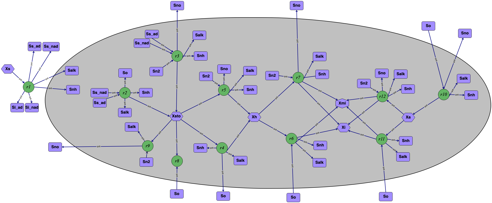

.. _activated_sludge_model:

Activated Sludge Model (ASM3h)
===============================

The Activated Sludge Model 3 extended (ASM3h) is a comprehensive reaction model for simulating biological 
wastewater treatment processes. It belongs to the Activated Sludge Models (ASM) family, a set of standardized 
models developed by the International Water Association (IWA). The ASM3h model describes the fate of 13 
biochemical components in wastewater treatment systems.

Model Components
~~~~~~~~~~~~~~~~

The ASM3h model tracks 13 biochemical components representing species and compounds in wastewater:

.. list-table::
   :header-rows: 1
   :widths: 20 80

   * - Abbreviation
     - Component
   * - :math:`S_O`
     - Dissolved oxygen
   * - :math:`S_S`
     - Readily biodegradable substrate
   * - :math:`S_{NH}`
     - Ammonium
   * - :math:`S_{NO}`
     - Nitrite and nitrate
   * - :math:`S_{N2}`
     - Dinitrogen, released by denitrification
   * - :math:`S_{ALK}`
     - Alkalinity, bicarbonate
   * - :math:`S_I`
     - Soluble inert organic
   * - :math:`X_I`
     - Inert Particulate organic
   * - :math:`X_S`
     - Slowly biodegradable substrate
   * - :math:`X_H`
     - Heterotrophic biomass
   * - :math:`X_{STO}`
     - Organics stored by heterotrophs
   * - :math:`X_A`
     - Autotrophic, nitrifying biomass
   * - :math:`X_{MI}`
     - Mineral particulate matter from biomass

For the reaction equations, :math:`c_i^\kappa` denotes the concentration of component :math:`i` in the bulk (:math:`\kappa=b`) or particle liquid (:math:`\kappa=p`) phase.
With fractionation, :math:`S_S` and :math:`S_I` are each split into adsorbable and non-adsorbable components, denoted by :math:`S_{S,\mathrm{ad}}`, :math:`S_{S,\mathrm{non-ad}}`, :math:`S_{I,\mathrm{ad}}`, and :math:`S_{I,\mathrm{non-ad}}`.
The configuration names ``SS`` and ``SI`` refer to the non-adsorbable components when fractionation is enabled; in the rate equations, :math:`c_{S_S}^\kappa = c_{S_S,\mathrm{non-ad}}^\kappa` and :math:`c_{S_I}^\kappa = c_{S_I,\mathrm{non-ad}}^\kappa` in this case.
Their phase-specific totals are

.. math::

   c_{S_S,\mathrm{tot}}^\kappa = c_{S_S,\mathrm{non-ad}}^\kappa + c_{S_S,\mathrm{ad}}^\kappa, \qquad
   c_{S_I,\mathrm{tot}}^\kappa = c_{S_I,\mathrm{non-ad}}^\kappa + c_{S_I,\mathrm{ad}}^\kappa.

Without fractionation, :math:`c_{S_S,\mathrm{tot}}^\kappa = c_{S_S}^\kappa` and :math:`c_{S_I,\mathrm{tot}}^\kappa = c_{S_I}^\kappa`.

The net flux for each component is computed using the stoichiometric matrix :math:`S \in \mathbb{R}^{13 \times 13}` 
and a reaction rate vector :math:`\varphi_j(c)`, where subscript :math:`j` denotes the reaction index. 
The ASM3h model comprises 13 biochemical reactions detailed below.

Biochemical Reaction Equations
~~~~~~~~~~~~~~~~~~~~~~~~~~~~~~~

.. list-table::
    :header-rows: 1
    :widths: 15 35 50

    * - Reaction Number
      - Reaction Description
      - Rate Equation
    * - :math:`r_1`
      - Hydrolysis of organic structures
      - :math:`k_{h,20} \cdot f_T^{0.04} \cdot \frac{c_{X_S}^\kappa/c_{X_H}^\kappa}{c_{X_S}^\kappa/c_{X_H}^\kappa + K_X} \cdot c_{X_H}^\kappa`
    * - :math:`r_2`
      - Aerobic storage of :math:`S_S`
      - :math:`k_{STO} \cdot \frac{c_{S_O}^\kappa}{c_{S_O}^\kappa + K_{h,O2}} \cdot \frac{c_{S_S}^\kappa}{c_{S_S,\mathrm{tot}}^\kappa + K_{h,SS}} \cdot c_{X_H}^\kappa`
    * - :math:`r_3`
      - Anoxic storage of :math:`S_S`
      - :math:`k_{STO} \cdot \eta_{h,NO3} \cdot \frac{K_{h,O2}}{c_{S_O}^\kappa + K_{h,O2}} \cdot \frac{c_{S_{NO}}^\kappa}{c_{S_{NO}}^\kappa + K_{h,NO3}} \cdot \frac{c_{S_S}^\kappa}{c_{S_S,\mathrm{tot}}^\kappa + K_{h,SS}} \cdot c_{X_H}^\kappa`
    * - :math:`r_4`
      - Aerobic growth of :math:`X_H`
      - :math:`\mu_H \cdot \frac{c_{S_O}^\kappa}{c_{S_O}^\kappa + K_{h,O2}} \cdot \frac{c_{X_{STO}}^\kappa/c_{X_H}^\kappa}{c_{X_{STO}}^\kappa/c_{X_H}^\kappa + K_{h,STO}} \cdot \frac{c_{S_{NH}}^\kappa}{c_{S_{NH}}^\kappa + K_{h,NH4}} \cdot \frac{c_{S_{ALK}}^\kappa}{c_{S_{ALK}}^\kappa + K_{h,ALK}} \cdot c_{X_H}^\kappa`
    * - :math:`r_5`
      - Anoxic growth of :math:`X_H` (denitrification)
      - :math:`\mu_H \cdot \eta_{h,NO3} \cdot \frac{K_{h,O2}}{c_{S_O}^\kappa + K_{h,O2}} \cdot \frac{c_{S_{NO}}^\kappa}{c_{S_{NO}}^\kappa + K_{h,NO3}} \cdot \frac{c_{X_{STO}}^\kappa/c_{X_H}^\kappa}{c_{X_{STO}}^\kappa/c_{X_H}^\kappa + K_{h,STO}} \cdot \frac{c_{S_{NH}}^\kappa}{c_{S_{NH}}^\kappa + K_{h,NH4}} \cdot \frac{c_{S_{ALK}}^\kappa}{c_{S_{ALK}}^\kappa + K_{h,ALK}} \cdot c_{X_H}^\kappa`
    * - :math:`r_6`
      - Aerobic endogenous respiration of :math:`X_H`
      - :math:`b_H \cdot \frac{c_{S_O}^\kappa}{c_{S_O}^\kappa + K_{h,O2}} \cdot c_{X_H}^\kappa`
    * - :math:`r_7`
      - Anoxic endogenous respiration of :math:`X_H`
      - :math:`b_H \cdot \eta_{h,end} \cdot \frac{K_{h,O2}}{c_{S_O}^\kappa + K_{h,O2}} \cdot \frac{c_{S_{NO}}^\kappa}{c_{S_{NO}}^\kappa + K_{h,NO3}} \cdot c_{X_H}^\kappa`
    * - :math:`r_8`
      - Aerobic respiration of internal cell storage products
      - :math:`b_H \cdot \frac{c_{S_O}^\kappa}{c_{S_O}^\kappa + K_{h,O2}} \cdot \frac{c_{X_{STO}}^\kappa}{c_{X_{STO}}^\kappa + K_{h,STO}} \cdot c_{X_H}^\kappa`
    * - :math:`r_9`
      - Anoxic respiration of internal cell storage products
      - :math:`b_H \cdot \eta_{h,end} \cdot \frac{K_{h,O2}}{c_{S_O}^\kappa + K_{h,O2}} \cdot \frac{c_{S_{NO}}^\kappa}{c_{S_{NO}}^\kappa + K_{h,NO3}} \cdot \frac{c_{X_{STO}}^\kappa}{c_{X_{STO}}^\kappa + K_{h,STO}} \cdot c_{X_H}^\kappa`
    * - :math:`r_{10}`
      - Aerobic growth of :math:`X_A`
      - :math:`\mu_{AUT} \cdot \frac{c_{S_O}^\kappa}{c_{S_O}^\kappa + K_{N,O2}} \cdot \frac{c_{S_{NH}}^\kappa}{c_{S_{NH}}^\kappa + K_{N,NH4}} \cdot \frac{c_{S_{ALK}}^\kappa}{c_{S_{ALK}}^\kappa + K_{N,ALK}} \cdot c_{X_A}^\kappa`
    * - :math:`r_{11}`
      - Aerobic endogenous respiration of :math:`X_A`
      - :math:`b_{AUT} \cdot \frac{c_{S_O}^\kappa}{c_{S_O}^\kappa + K_{N,O2}} \cdot c_{X_A}^\kappa`
    * - :math:`r_{12}`
      - Anoxic endogenous respiration of :math:`X_A`
      - :math:`b_{AUT} \cdot \eta_{N,end} \cdot \frac{K_{N,O2}}{c_{S_O}^\kappa + K_{N,O2}} \cdot \frac{c_{S_{NO}}^\kappa}{c_{S_{NO}}^\kappa + K_{h,NO3}} \cdot c_{X_A}^\kappa`
    * - :math:`r_{13}`
      - Aeration
      - :math:`\frac{iO_2}{1000}`
    * - :math:`r_{14}`
      - Anoxic storage of :math:`S_{S,\mathrm{ad}}` (optional)
      - :math:`k_{STO} \cdot \eta_{h,NO3} \cdot \frac{K_{h,O2}}{c_{S_O}^\kappa + K_{h,O2}} \cdot \frac{c_{S_S,\mathrm{ad}}^\kappa}{c_{S_S,\mathrm{tot}}^\kappa + K_{h,SS}} \cdot \frac{c_{S_{NO}}^\kappa}{c_{S_{NO}}^\kappa + K_{h,NO3}} \cdot c_{X_H}^\kappa`
    * - :math:`r_{15}`
      - Aerobic storage of :math:`S_{S,\mathrm{ad}}` (optional)
      - :math:`k_{STO} \cdot \frac{c_{S_O}^\kappa}{c_{S_O}^\kappa + K_{h,O2}} \cdot \frac{c_{S_S,\mathrm{ad}}^\kappa}{c_{S_S,\mathrm{tot}}^\kappa + K_{h,SS}} \cdot c_{X_H}^\kappa`

Reactions :math:`r_{14}` and :math:`r_{15}` are only active when 15 components are defined (including :math:`S_{S,\mathrm{ad}}` and :math:`S_{I,\mathrm{ad}}`).

Stoichiometric Matrix
~~~~~~~~~~~~~~~~~~~~~

The stoichiometric matrix :math:`S` encodes the mass balance coefficients for each biochemical reaction:
When fractionation is enabled, the :math:`S_S` and :math:`S_I` rows denote :math:`S_{S,\mathrm{non-ad}}` and :math:`S_{I,\mathrm{non-ad}}`, respectively.

.. list-table::
    :header-rows: 1
    :widths: 10 7 7 7 7 7 7 7 7 7 7 7 7 7 7 7

    * - Component\\Reaction
      - :math:`r_1`
      - :math:`r_2`
      - :math:`r_3`
      - :math:`r_4`
      - :math:`r_5`
      - :math:`r_6`
      - :math:`r_7`
      - :math:`r_8`
      - :math:`r_9`
      - :math:`r_{10}`
      - :math:`r_{11}`
      - :math:`r_{12}`
      - :math:`r_{13}`
      - :math:`r_{14}^*`
      - :math:`r_{15}^*`
    * - :math:`S_O`
      - 0
      - :math:`Y_{STO,aer} - 1`
      - :math:`Y_{STO,anox} - 1`
      - :math:`1 - 1/Y_{H,aer}`
      - :math:`1 - 1/Y_{H,anox}`
      - :math:` f_{XI} - 1`
      - :math:`f_{XI} - 1`
      - -1
      - -1
      - :math:`-(64/14) \cdot 1/Y_A + 1`
      - :math:`f_{XI} - 1`
      - :math:`f_{XI} - 1`
      - 1
      - 0
      - 0
    * - :math:`S_S`
      - :math:`(1 - f_{SI})(1 - f_{SS,ad})`
      - -1
      - -1
      - 0
      - 0
      - 0
      - 0
      - 0
      - 0
      - 0
      - 0
      - 0
      - 0
      - 0
      - 0
    * - :math:`S_{S,\mathrm{ad}}^*`
      - :math:`(1 - f_{SI}) \cdot f_{SS,ad}`
      - 0
      - 0
      - 0
      - 0
      - 0
      - 0
      - 0
      - 0
      - 0
      - 0
      - 0
      - 0
      - -1
      - -1
    * - :math:`S_{NH}`
      - :math:`i_{N,XS} - i_{N,SI} \cdot f_{SI} - (1 - f_{SI}) \cdot i_{N,SS}`
      - :math:`i_{N,SS}`
      - :math:`i_{N,SS}`
      - :math:`-i_{N,BM}`
      - :math:`-i_{N,BM}`
      - :math:`i_{N,BM} - f_{XI} \cdot i_{N,XI}`
      - :math:`i_{N,BM} -f_{XI} \cdot i_{N,XI}`
      - 0
      - 0
      - :math:`-1/Y_A - i_{N,BM}`
      - :math:`f_{XI} \cdot i_{N,XI} + i_{N,BM}`
      - :math:`f_{XI} \cdot i_{N,XI} + i_{N,BM}`
      - 0
      - 0
      - 0
    * - :math:`S_{NO}`
      - 0
      - 0
      - :math:`(Y_{STO,anox} - 1) / (40/14)`
      - 0
      - :math:`(1 - 1/Y_{H,anox}) / (40/14)`
      - 0
      - :math:`(f_{XI} - 1) / (40/14)`
      - 0
      - :math:`-14/40`
      - :math:`1/Y_A`
      - 0
      - :math:`(f_{XI} - 1) / (40/14)`
      - 0
      - 0
      - 0
    * - :math:`S_{N2}`
      - 0
      - 0
      - :math:`(1 - Y_{STO,anox}) / (40/14)`
      - 0
      - :math:`(1/Y_{H,anox} - 1) / (40/14)`
      - 0
      - :math:`(-f_{XI} - 1) / (40/14)`
      - 0
      - :math:`--14/40`
      - 0
      - 0
      - :math:`(1 + f_{XI} ) / (40/14)`
      - 0
      - 0
      - 0
    * - :math:`S_{ALK}`
      - :math:`(i_{N,XS} - i_{N,SI} \cdot f_{SI} - (1 - f_{SI}) \cdot i_{N,SS})/14`
      - :math:`i_{N,SS} / 14`
      - :math:`i_{N,SS} / 14 - (Y_{STO,anox} - 1) / 40`
      - :math:`-i_{N,BM} / 14`
      - :math:`-i_{N,BM} / 14 - (1 - 1/Y_{H,anox}) / 40`
      - :math:`(-f_{XI} \cdot i_{N,XI} + i_{N,BM}) / 14`
      - :math:`(-f_{XI} \cdot i_{N,XI} + i_{N,BM}) / 14  (-f_{XI} + 1) / 40`
      - 0
      - :math:`1/40`
      - :math:`-(1/Y_A) 1/7- i_{N,BM}/14`
      - :math:`f_{XI} \cdot i_{N,XI} + i_{N,BM} / 14`
      - :math:`(-f_{XI} \cdot i_{N,XI} + i_{N,BM})/14 - (f_{XI} - 1) / 40`
      - 0
      - 0
      - 0
    * - :math:`S_I`
      - :math:`f_{SI}(1 - f_{SI,ad})`
      - 0
      - 0
      - 0
      - 0
      - 0
      - 0
      - 0
      - 0
      - 0
      - 0
      - 0
      - 0
      - 0
      - 0
    * - :math:`S_{I,\mathrm{ad}}^*`
      - :math:`f_{SI} \cdot f_{SI,ad}`
      - 0
      - 0
      - 0
      - 0
      - 0
      - 0
      - 0
      - 0
      - 0
      - 0
      - 0
      - 0
      - 0
      - 0
    * - :math:`X_I`
      - 0
      - 0
      - 0
      - 0
      - 0
      - :math:`f_{XI}`
      - :math:`f_{XI}`
      - 0
      - 0
      - 0
      - :math:`f_{XI}`
      - :math:`f_{XI}`
      - 0
      - 0
      - 0
    * - :math:`X_S`
      - -1
      - 0
      - 0
      - 0
      - 0
      - 0
      - 0
      - 0
      - 0
      - 0
      - 0
      - 0
      - 0
      - 0
      - 0
    * - :math:`X_H`
      - 0
      - 0
      - 0
      - 1
      - 1
      - -1
      - -1
      - 0
      - 0
      - 0
      - 0
      - 0
      - 0
      - 0
      - 0
    * - :math:`X_{STO}`
      - 0
      - :math:`Y_{STO,aer}`
      - :math:`Y_{STO,anox}`
      - :math:`-1/Y_{H,aer}`
      - :math:`-1/Y_{H,anox}`
      - 0
      - 0
      - -1
      - -1
      - 0
      - 0
      - 0
      - 0
      - :math:`Y_{STO,anox}`
      - :math:`Y_{STO,aer}`
    * - :math:`X_A`
      - 0
      - 0
      - 0
      - 0
      - 0
      - 0
      - 0
      - 0
      - 0
      - 1
      - -1
      - -1
      - 0
      - 0
      - 0
    * - :math:`X_{MI}`
      - 0
      - 0
      - 0
      - 0
      - 0
      - :math:`f_{XMI,BI}`
      - :math:`f_{XMI,BI}`
      - 0
      - 0
      - 0
      - :math:`f_{XMI,BI}`
      - :math:`f_{XMI,BI}`
      - 0
      - 0
      - 0

:sup:`*` Optional: only active when 15 components are defined (:math:`S_{S,\mathrm{ad}}` and :math:`S_{I,\mathrm{ad}}`).

    Network representation of the ASM3h model.

Model Parameters
~~~~~~~~~~~~~~~~

Stoichiometric Parameters
-------------------------

.. list-table::
   :header-rows: 1
   :widths: 20 60 20

   * - Symbol
     - Description
     - Unit
   * - :math:`i_{N,SI}`
     - Nitrogen content of soluble inert organics
     - :math:`g~N~(g~COD)^{-1}`
   * - :math:`i_{N,SS}`
     - Nitrogen content of readily biodegradable substrate
     - :math:`g~N~(g~COD)^{-1}`
   * - :math:`i_{N,XI}`
     - Nitrogen content of inert particulate organics
     - :math:`g~N~(g~COD)^{-1}`
   * - :math:`i_{N,XS}`
     - Nitrogen content of slowly biodegradable substrate
     - :math:`g~N~(g~COD)^{-1}`
   * - :math:`i_{N,BM}`
     - Nitrogen content of biomass
     - :math:`g~N~(g~COD)^{-1}`
   * - :math:`i_{VSS,XI}`
     - VSS to COD ratio for inert particulates
     - :math:`g~VSS~(g~COD)^{-1}`
   * - :math:`i_{VSS,XS}`
     - VSS to COD ratio for slowly biodegradable substrate
     - :math:`g~VSS~(g~COD)^{-1}`
   * - :math:`i_{VSS,STO}`
     - VSS to COD ratio for storage products
     - :math:`g~VSS~(g~COD)^{-1}`
   * - :math:`i_{VSS,BM}`
     - VSS to COD ratio for biomass
     - :math:`g~VSS~(g~COD)^{-1}`
   * - :math:`i_{TSS/VSS,BM}`
     - TSS to VSS ratio for biomass
     - :math:`g~TSS~(g~VSS)^{-1}`
   * - :math:`f_{SI}`
     - Fraction of :math:`S_I` from hydrolysis
     - dimensionless
   * - :math:`f_{XI}`
     - Fraction of :math:`X_I` from endogenous respiration
     - dimensionless
   * - :math:`f_{ISS,BM,prod}`
     - Fraction of ISS from biomass production
     - dimensionless
   * - :math:`Y_{H,aer}`
     - Aerobic yield of heterotrophs
     - :math:`g~COD~(g~COD)^{-1}`
   * - :math:`Y_{H,anox}`
     - Anoxic yield of heterotrophs
     - :math:`g~COD~(g~COD)^{-1}`
   * - :math:`Y_{STO,aer}`
     - Aerobic yield of storage
     - :math:`g~COD~(g~COD)^{-1}`
   * - :math:`Y_{STO,anox}`
     - Anoxic yield of storage
     - :math:`g~COD~(g~COD)^{-1}`
   * - :math:`Y_A`
     - Yield of autotrophs
     - :math:`g~COD~(g~N)^{-1}`

Kinetic Parameters
------------------

.. list-table::
   :header-rows: 1
   :widths: 20 60 20

   * - Symbol
     - Description
     - Unit
   * - :math:`k_H`
     - Hydrolysis rate constant (20 °C)
     - :math:`d^{-1}`
   * - :math:`K_{STO}`
     - Maximum storage rate (20 °C)
     - :math:`d^{-1}`
   * - :math:`\mu_H`
     - Heterotrophic max. growth rate (20 °C)
     - :math:`d^{-1}`
   * - :math:`b_H`
     - Rate constant for lysis and decay (20 °C)
     - :math:`d^{-1}`
   * - :math:`\mu_{AUT}`
     - Autotrophic max. growth rate (20 °C)
     - :math:`d^{-1}`
   * - :math:`b_{AUT}`
     - Rate constant for decay of autotrophs (20 °C)
     - :math:`d^{-1}`

Anoxic Reduction Factors
------------------------

.. list-table::
   :header-rows: 1
   :widths: 20 60 20

   * - Symbol
     - Description
     - Unit
   * - :math:`\eta_{HNO_3}`
     - Anoxic reduction factor for heterotrophic growth
     - dimensionless
   * - :math:`\eta_{H,end}`
     - Anoxic reduction factor for endogenous respiration of :math:`X_H`
     - dimensionless
   * - :math:`\eta_{N,end}`
     - Anoxic reduction factor for endogenous respiration of :math:`X_A`
     - dimensionless

Saturation/Inhibition Coefficients
----------------------------------

.. list-table::
   :header-rows: 1
   :widths: 20 60 20

   * - Symbol
     - Description
     - Unit
   * - :math:`K_X`
     - Saturation coefficient for particulate COD
     - :math:`g~COD~(g~COD)^{-1}`
   * - :math:`K_{H,O_2}`
     - Saturation coefficient for oxygen (heterotrophs)
     - :math:`g~O_2~m^{-3}`
   * - :math:`K_{H,SS}`
     - Saturation coefficient for readily biodegradable substrates
     - :math:`g~COD~m^{-3}`
   * - :math:`K_{H,NO_3}`
     - Saturation coefficient for nitrate (heterotrophs)
     - :math:`g~N~m^{-3}`
   * - :math:`K_{H,NH_4}`
     - Saturation coefficient for ammonium (nutrient)
     - :math:`g~N~m^{-3}`
   * - :math:`K_{H,ALK}`
     - Saturation coefficient for alkalinity (heterotrophs)
     - :math:`mol~m^{-3}`
   * - :math:`K_{H,STO}`
     - Saturation coefficient for storage products
     - :math:`g~COD~(g~COD)^{-1}`
   * - :math:`K_{N,O_2}`
     - Saturation coefficient for oxygen (autotrophs)
     - :math:`g~O_2~m^{-3}`
   * - :math:`K_{N,NH_4}`
     - Saturation coefficient for ammonium (substrate)
     - :math:`g~N~m^{-3}`
   * - :math:`K_{N,ALK}`
     - Saturation coefficient for alkalinity (autotrophs)
     - :math:`mol~m^{-3}`

Temperature Dependence
----------------------

Kinetic rates are corrected for temperature using Arrhenius-type expressions:

.. math::

   k(T) = k_{20} \cdot \exp\left(-\theta \cdot (20 - T)\right)

with temperature coefficients:

- :math:`\theta = 0.04` for hydrolysis
- :math:`\theta = 0.06952` for heterotrophic processes (:math:`K_{STO}`, :math:`\mu_H`, :math:`b_H`)
- :math:`\theta = 0.105` for autotrophic processes (:math:`\mu_{AUT}`, :math:`b_{AUT}`)

Optional Parameters
-------------------

.. list-table::
   :header-rows: 1
   :widths: 20 60 20

   * - Symbol
     - Description
     - Unit
   * - :math:`f_{SI,ad}`
     - Fraction of adsorbable :math:`S_I`
     - dimensionless
   * - :math:`f_{SS,ad}`
     - Fraction of adsorbable :math:`S_S`
     - dimensionless
   * - :math:`iO_2`
     - Aeration oxygen input rate
     - :math:`g~O_2~m^{-3}~d^{-1}`
   * - :math:`V`
     - Reactor volume (for aeration)
     - :math:`m^3`

Configuration in CADET
~~~~~~~~~~~~~~~~~~~~~~

For configuration details, see :ref:`activated_sludge_model_config`.

Aeration Strategy
-----------------

The ASM3h model includes an aeration reaction (:math:`r_{13}`) that is activated when both ``ASM3_IO2`` and ``ASM3_V`` are set.
The aeration rate is computed as :math:`iO_2 / 1000`. To disable aeration, omit these parameters.
For more flexible aeration handling, model oxygen input explicitly via the Inlet unit operation (see :ref:`inlet_operation`).

Substrate Fractionation
-----------------------

The organic substrates can be fractionated into adsorbable and non-adsorbable components via ``ASM3_FSI_AD`` and ``ASM3_FSS_AD``.
This requires at least 15 components (including ``SI_ad`` and ``SS_ad``, corresponding to :math:`S_{I,\mathrm{ad}}` and :math:`S_{S,\mathrm{ad}}`) and enables coupling with binding models for adsorptive interactions during biological treatment. If fewer than 15 components are defined, adsorbed components are disabled.

When fractionation is enabled, reactions :math:`r_{14}` and :math:`r_{15}` become active for storage of adsorbable substrate :math:`S_{S,\mathrm{ad}}`.

Implementation Notes
--------------------

- Component indices can be customized via ``ASM3_COMP_IDX`` if components are ordered differently or offset.
- Some kinetic terms contain ratios of particulate substrate to biomass. A smooth lower bound on the biomass concentration is used to regularize these ratios:

.. math::

    c_{X_H,\mathrm{lb}} = c_{X_H,\mathrm{min}} + \frac{1}{2}\left(c_{X_H} - c_{X_H,\mathrm{min}} + \sqrt{\left(c_{X_H} - c_{X_H,\mathrm{min}}\right)^2 + \varepsilon_X^2}\right)

References
~~~~~~~~~~

TODO
